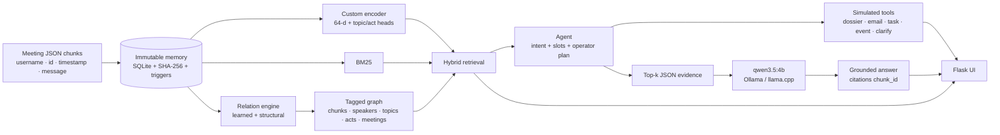

# Semantic Meeting Memory — v6

An end-to-end semantic agent over meeting transcripts. It ingests immutable JSON
message chunks, learns a small French encoder, extracts typed units and relations,
retrieves with a hybrid of lexical/dense/ColBERT/graph/temporal signals, routes
intents to simulated tools, and grounds a local `qwen3.5:4b` answer in the top-k
JSON chunks. The Flask UI exposes search, meetings, datasets, benchmarks, the
discussion graph and the agent with its tool trace.

All corpora are synthetic. No private meeting data is used.

## Architecture



Plain fallback:

```text
JSON chunks -> immutable SQLite -> custom encoder + topic/act heads
                                 -> relation engine -> tagged graph
BM25 + custom dense + ColBERT MaxSim + graph PPR + temporal
   -> hybrid ranker -> agent (intent/slots)
   -> tools + top-k JSON -> qwen3.5:4b -> answer with citations -> Flask UI
```

### Step by step

1. **Ingestion.** Each meeting message is stored exactly as uploaded
   (`username`, `message_id`, `timestamp`, `message`), keyed by an external
   `chunk_id`. SHA-256 hashes and SQLite triggers prevent source mutation.
   Derived vectors, features, units and relations live in separate tables linked
   by `chunk_id`.
2. **Semantic encoding.** A one-layer Transformer trained from scratch (≈94k
   parameters, 64-d) produces message vectors plus topic and discourse-act
   probabilities. Training uses InfoNCE with in-batch negatives and same-meeting
   hard negatives; checkpoint selection uses validation MRR@10.
3. **Units and relations.** Acts are mapped to semantic units (`decision`,
   `commitment`, `risk`, `idea`, `fact`). A supervised relation classifier covers
   `supports`, `contradicts`, `supersedes`, `creates_action`, `answers`,
   `unrelated`. A second, structural relation engine uses project identity,
   chronology, act cues and explicit date references; it is the OOD/hybrid path.
4. **Memory.** Meetings, summaries, meeting vectors, feature nodes/edges,
   semantic units and relations are persisted. The new transcribed corpus adds
   cross-session references, materialised as `references` edges in the graph.
5. **Retrieval.** Seven methods are evaluated on identical meeting-scoped
   queries: BM25, custom dense, feature-aware fusion, French ME5, multilingual E5,
   ColBERT-style late interaction and GraphRAG. GraphRAG fuses ColBERT MaxSim,
   BM25, differentiable personalized PageRank over the typed graph, a temporal
   subspace (Fourier time features + recency/interval operators), act matching
   and custom dense rank. Query operators (`latest`, `earliest`, `count`,
   author, date) are parsed deterministically; no template classifier can
   silently misroute them.
6. **Agent.** `agent_engine.py` classifies intent (7 classes), extracts slots,
   retrieves top-k evidence, executes the matching simulated tool, builds a
   grounded prompt from source JSON and calls the local LLM. The trace returned
   to the UI exposes every step.
7. **Interface.** Flask app: semantic search, meeting transcript manager,
   dataset import, benchmark, discussion graph, and agent chat with trace,
   evidence and action JSON.

### ColBERT note

The late-interaction implementation uses multilingual `BAAI/bge-m3` token
embeddings with the ColBERT MaxSim scoring function. It is **not** the
ColBERTv2 checkpoint/PLAID stack: there is no residual compression, no PLAID
index, and no late chunking. ColBERTv2's released checkpoint is English
MS-MARCO; BGE-M3 is the multilingual equivalent appropriate for this corpus.
Chunks are turns/messages, not late-chunked long documents.

## Datasets

| Corpus | Meetings | Messages | Projects | Use |
|---|---:|---:|---:|---|
| Synthetic French (v1-v5) | 60 | 3,600 | 15 | train/validation/test, 1,260 queries |
| Transcribed v6 | 30 | 1,200 | 10 | evaluation only, 179 queries |
| Hand-written OOD | — | — | — | 18 paraphrases / multi-constraint queries |
| Agent evaluation | — | — | — | 18 intent/tool/recipient/dossier cases |
| Relation hard cases | — | — | — | 40 typed OOD pairs |

Synthetic splits are project-grouped: train 9 projects / 36 meetings, validation
3 / 12, test 3 / 12. The transcribed corpus spans 10 unrelated subjects
(mobile, data migration, security, hiring, pricing, support, accessibility,
infrastructure, partnerships, compliance). Every meeting contains three
decisions, commitments, an objection and a risk, written as messy French
transcription (fillers, false starts, repeated words, lowercase). Later sessions
cite the previous session by ISO date; each project's first meeting cites the
previous project's first session. The global graph contains 85 cross-meeting
reference edges.

Transcribed queries: 30 last-message, 30 first-decision, 30 decision-count
(multi-gold), 30 last-message + author + time, 30 commitment-owner, 29
cross-meeting. All data is generated locally by `generate_transcribed_corpus.py`;
no external licence or private transcript is involved.

### Annotation contracts

```json
{
  "unit_id": "tr-mobile-r1:007",
  "source_id": "tr-mobile-r1",
  "source_date": "2026-01-05",
  "type": "decision",
  "statement": "refondre l'écran d'accueil avec une seule action principale",
  "speaker": "david",
  "evidence": "décision: refondre l'écran d'accueil ...",
  "status": "active"
}
```

```json
{ "from_id": "tr-mobile-r1:007", "to_id": "tr-mobile-r1:008",
  "relation": "creates_action", "evidence_source_id": "tr-mobile-r1" }
```

```json
{
  "intent": "draft_email",
  "tool_candidate": "email.create_draft",
  "recipient": {"name": "david", "email": null,
                "evidence_unit_ids": ["tr-mobile-r1:008"],
                "resolution_status": "email_missing"},
  "subject": "Suivi — Refonte mobile",
  "body": "Bonjour David, ...",
  "source_unit_ids": ["tr-mobile-r1:008"],
  "needs_confirmation": true,
  "executed": false
}
```

Agent evaluation runs the deterministic engine with the LLM disabled, then a
separate LLM smoke test records generation latency and citations; the LLM cannot
improve or hide retrieval/intent/tool errors in the deterministic metrics.

## Results

### Retrieval — synthetic held-out test (252 templated queries, meeting-scoped)

| Method | Recall@1 | Recall@5 | MRR@10 |
|---|---:|---:|---:|
| BM25 | 17.9% | 48.4% | 0.295 |
| Dense · custom | 66.7% | 90.1% | 0.762 |
| Feature-aware | **92.1%** | **100.0%** | **0.956** |
| French ME5 | 83.3% | 94.8% | 0.882 |
| Multilingual E5 | 82.1% | 95.2% | 0.876 |
| ColBERT · BGE-M3 | 31.7% | 61.5% | 0.437 |
| GraphRAG | 52.0% | 81.7% | 0.646 |

Feature-aware wins here because these questions were generated from the same
templates as the custom encoder's training data. This table is a regression
check, not an OOD claim.

### Retrieval — transcribed v6 (179 queries, messy, multi-gold)

| Method | Recall@1 | Recall@5 | MRR@10 |
|---|---:|---:|---:|
| BM25 | 16.4% | 29.8% | 0.245 |
| Dense · custom | 1.5% | 12.1% | 0.090 |
| Feature-aware | 27.7% | 34.5% | 0.321 |
| French ME5 | 19.2% | 32.6% | 0.312 |
| Multilingual E5 | 18.2% | 33.1% | 0.277 |
| ColBERT · BGE-M3 | 30.0% | 64.1% | 0.511 |
| **GraphRAG** | **54.0%** | **96.1%** | **0.809** |

GraphRAG by category (Recall@5 / MRR): last message 1.00 / 0.87, first decision
1.00 / 0.56, decision count 0.91 / 0.92, last message + author + time 1.00 /
1.00, commitment owner 0.97 / 0.82, cross-meeting 0.89 / 0.69. Recall@1 is
structurally low on multi-gold queries (three decisions cannot occupy one slot).

### Retrieval — hand-written OOD (18 queries)

| Method | Recall@1 | Recall@5 | MRR@10 |
|---|---:|---:|---:|
| BM25 | 44.4% | 55.6% | 0.513 |
| Dense · custom | 33.3% | 33.3% | 0.373 |
| Feature-aware | 22.2% | 44.4% | 0.315 |
| ColBERT | 72.2% | 88.9% | 0.787 |
| **GraphRAG** | **94.4%** | **100.0%** | **0.972** |

The contrast between the synthetic table and the two OOD tables is the point:
the old benchmark measured template matching; v6 measures paraphrases, counts,
multi-part questions and cross-session references.

### Relations

| Set | Method | Macro-F1 | Accuracy |
|---|---|---:|---:|
| Synthetic test pairs | learned classifier | 0.970 | 0.968 |
| Transcribed hard cases | learned classifier (OOD) | 0.056 | 0.050 |
| Transcribed hard cases | structural engine | 1.000 | 1.000 |

The synthetic classifier does not transfer to the typed transcribed relations;
the structural engine uses project identity, chronology, act cues and date
references. The hard-case set is constructed from those same structural cues, so
1.0 is a rule-coverage ceiling, not a claim of open-world relation understanding.
The production design is the hybrid: learned model when signals match its
training distribution, structural engine for typed/dated provenance.

### Other modules

- Intent classifier: 0.971 accuracy / 0.971 macro-F1 (synthetic held-out).
- Feature heads: topic Macro-F1 0.684, act Macro-F1 0.986.
- Agent evaluation (18 hand-written cases, deterministic tools, no LLM):
  intent 100%, recipient 100%, email-missing 100%, dossier section coverage
  100%, dossier citation coverage 100%, clarification 100%, hypothetical
  no-action 100%, all actions unexecuted 100%, answer citation rate 83.3%.
- System: mean 237 ms per agent run, 231 ms retrieval, peak VRAM 1.26 GB,
  peak RSS 5.7 GB. LLM smoke (qwen3.5:4b, `think:false`): ~3.0 s, 236 generated
  tokens, 1,273 prompt tokens, 7 valid citations.

## Agent and LLM

The **Agent** tab streams NDJSON from `POST /api/agent`:

- `analyze`: intent, slots, hypothetical detection
- `retrieval`: GraphRAG top-k, plan and latency
- `tool`: dossier/email/task/event/compare/clarify (simulated, `executed:false`)
- `llm`: model, latency, token counts
- `result`: grounded answer, citations, evidence JSON, action contract

The LLM only sees the query plus the top-k source JSON. The system prompt forbids
inventing people, dates, decisions or e-mails, requires `[chunk_id]` citations,
states that proposals are not decisions and hypotheticals trigger no action.
The last six conversation turns are passed back as chat history; retrieval and
tool routing are recomputed for every turn. If Ollama is unavailable, the agent
returns a deterministic evidence answer and marks `llm.status` accordingly.

```bash
# Ollama is already installed with qwen3.5:4b in this environment.
OLLAMA_MODEL=qwen3.5:4b OLLAMA_URL=http://127.0.0.1:11434 python app.py
```

`think` is disabled (`think:false`); otherwise qwen3.5 spends the whole token
budget in its reasoning channel and returns empty content.

Tool contracts are returned as JSON: recipient (name, email `null`, evidence id,
`resolution_status`), subject/body, dossier sections with per-item `chunk_id`,
task/event proposal, `needs_confirmation:true`, `executed:false`. Recipients
are never invented; ambiguous or missing owners produce `clarify`.

## Piscine coverage

| Piscine requirement | v6 |
|---|---|
| Lexical + dense + pretrained baselines | BM25, custom dense, ME5, E5, ColBERT |
| Contrastive learning, hard negatives, ablations | custom encoder + InfoNCE + same-meeting negatives |
| Relations `supports/contradicts/supersedes/creates_action/answers/unrelated` | learned + structural engine |
| Typed units with source, date, speaker, status | SQLite units, immutable JSON, triggers |
| Hybrid retrieval, filters, reranking | GraphRAG, operator plan, temporal subspace |
| Intent classification + slots | 7 intents, author/project/topic/date/count slots |
| Source-grounded answers | top-k JSON + citations |
| Structured multi-source dossier | sections + citations + missing-information |
| Email to the right person, no invented address | recipient resolution, `email:null`, clarification |
| Task / event proposals, no execution | simulated tools, `executed:false` |
| Hypothetical must not trigger action | hypothetical guard + evaluation case |
| Retrieval/relations/intents/recipient/dossier/system metrics | `ood_results.json`, `agent_eval.json`, `relation_hard_cases_eval.json` |
| Interface | Flask UI, Agent tab, streaming trace |
| Data provenance and splits | synthetic corpora + generators + documented splits |
| Public/real dataset | not included; all data synthetic |
| Full ColBERTv2/PLAID | not used; multilingual BGE-M3 MaxSim |

## Run

```bash
python -m venv .venv && source .venv/bin/activate
pip install -r requirements.txt

# Synthetic v1-v5 corpus + custom encoder
python run_french_lab.py --force-data --epochs 6 --batch-size 32 --train-only
python run_french_lab.py --eval-only

# Transcribed v6 corpus + hard relation cases
python generate_transcribed_corpus.py
python generate_relation_hard_cases.py

# Evaluations
python evaluate_ood.py --device cuda --batch-size 64
python evaluate_agent.py
python evaluate_relations.py
python run_pretrained_comparison.py --batch-size 64

# UI
python app.py   # http://127.0.0.1:5000
```

The first GraphRAG/ColBERT query builds a token cache under `artifacts/hybrid/`
(≈333 MB for the 3,600-chunk synthetic corpus). The transcribed corpus is loaded
as the built-in dataset **Transcribed · 30 réunions**.

## Limits

- Corpora are synthetic; the transcribed set is messier and OOD, but still not a
  public meeting corpus. The piscine explicitly cautions against template-only
  evaluation; v6 mitigates it, it does not eliminate it.
- The learned relation classifier fails OOD; structural relations rely on typed
  cues. Open-world contradiction detection remains hard.
- ColBERTv2 compression/PLAID and late chunking are not implemented.
- The local 4B model can still phrase an unsupported sentence; citations and the
  no-action guard reduce, but do not remove, that risk. Every action is simulated.
- No real email/calendar/task connector is called; addresses are never invented.
- Latency is measured on an RTX 5060 Laptop; brute-force MaxSim is fine at this
  scale but is not a production ANN index.

The previous v5 README is preserved at [docs/README_V5.md](docs/README_V5.md).
