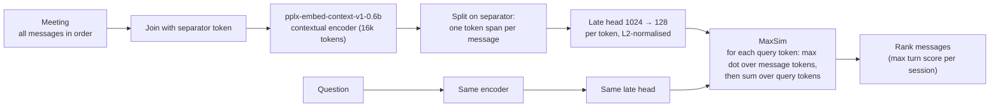

# Semantic Meeting Memory — Rexu v3

Rexu v3 is the shipped retriever: a frozen contextual encoder over the whole
meeting, a trained 1024→128 late-interaction head, and MaxSim. This repository
holds the engine, the three French meeting corpora it is measured on (v8, v9,
v10), and the comparison baselines.

## Corpora

All queries are **meeting-scoped**: the candidate pool is the 60 messages of the
query's own meeting (v8/v9) or the messages of its meeting (v10). The numbers
below are therefore within-meeting ranking, not cross-meeting search.

| corpus | meetings | messages | queries (train/val/test) | kind |
|---|---:|---:|---|---|
| v8 | 60 | 3,600 | 300 (200/50/50) | generated, all multi-hop |
| v9 | 60 | 3,600 | 300 (200/50/50) | generated, all multi-hop |
| v10 · Les Rivières de Sel | 5 | 275 | 19 (9/6/4) | hand-written, multi-hop facts |

v10 is the hand-written corpus (film production: *Les Rivières de Sel*, Max,
Maria, Atelier Nord, budget and launch revisions). v8/v9 are the generated
multi-hop corpora: 60 meetings × 60 messages, every test query has more than one
evidence message. The files are `data/v8_*.json`, `data/v9_*.json`,
`data/v10_*.json`.

## Rexu v3 architecture

Rexu v3 keeps the whole meeting in context instead of pooling each message
alone. Every message is a span separated by the encoder's separator token, so a
message vector already carries what was said before it. Query and document
tokens go through the same 1024→128 late head, and MaxSim scores a query token
against its best match anywhere in the message. No BGE-M3, no graph.



Training uses the v7, v8 and v9 train splits only: one positive message per
query plus five set-level hard negatives (same meeting, same topic, wrong
status/person/date), with the encoder frozen and the 128-d projection trained.
v10 is never seen during training or selection.

## Results (test splits, Rexu v3)

`R@1` / `R@5` — at least one gold evidence message at rank 1 / in the top 5;
`MRR` — reciprocal rank of the best gold message (0 beyond rank 10);
`EvidenceRecall@5` — mean fraction of all gold evidence in the top 5;
`AllHops@5` — share of queries where *every* gold evidence message is in the
top 5.

| corpus | R@1 | R@5 | MRR | EvidenceRecall@5 | AllHops@5 | n |
|---|---:|---:|---:|---:|---:|---:|
| v8 | 1.000 | 1.000 | 1.000 | 0.603 | 0.000 | 50 |
| v9 | 1.000 | 1.000 | 1.000 | 0.813 | 0.420 | 50 |
| v10 | 0.500 | 1.000 | 0.688 | 0.475 | 0.000 | 4 |

Raw values: `data/rexu_v3_eval.json`.

What the table says:

- **Finding one answering message is solved on v8/v9** (R@1 1.000) because the
  pool is the query's own meeting. v10's R@1 0.500 is four test queries, so
  treat it as an indication, not a rate.
- **Finding the whole chain is not.** AllHops@5 is 0.000 on v8, 0.420 on v9 and
  0.000 on v10; EvidenceRecall@5 is 0.60/0.81/0.48. In multi-hop terms the
  model reliably finds a hop, not all hops.
- v9 is coherent where v8 is not: same R@1, but the evidence coverage and
  AllHops@5 numbers move from .603/.000 to .813/.420.
- v8/v9/v10 values are not comparable to each other or to a cross-meeting
  benchmark; the candidate pool and the number of test queries differ.

### Real-data check (QMSum test, 244 queries / 35 meetings, meeting scope)

| Recall@1 | AnyR@1 | Recall@5 | AnyR@5 | MRR@10 | median best-gold rank |
|---:|---:|---:|---:|---:|---:|
| 0.029 | 0.262 | 0.074 | 0.541 | 0.382 | 5.0 |

On real ASR meeting transcripts the model usually finds a gold turn somewhere
in the top 10 (median rank 5) but rarely ranks it first. This is the honest
limit of the current head; the synthetic corpora above do not show it.

## Run

```bash
source .venv/bin/activate
pip install -r requirements.txt

# v10 test split, Rexu v3
python evaluate_v10.py

# rebuild the v8/v9/v10 numbers (also retrains the head)
python finetune_pplx_heads_multi.py

# UI
python app.py                               # http://127.0.0.1:5000
# or ./run_app.sh, which uses .venv/bin/python directly
```

## Defaults

- The UI default is **`v10`** with **`rexu_v3`**.
- `rexu_v3` = pplx-context(full meeting) → contextual 1024-d tokens →
  Dense(1024→128) → MaxSim.
- BM25, BGE-M3 dense, ColBERT and GraphRAG remain available as comparison
  baselines; they are not the default.
- Graph view: projects → meetings in a spaced grid; meeting view: message
  chunks → speakers/acts/topics, with `precedes` and relation edges. Large
  graphs use short meeting labels and retain full titles in the inspector.

## Limits

- Still synthetic, and v8/v9 are generated. v10 is hand-written but small:
  5 meetings and 4 test queries. A public corpus with decision annotations
  (AMI/ICSI/MeetingBank/QMSum) is the next required step; the QMSum row above
  is the first measurement in that direction.
- The relation classifier learns annotation-defined pair types; its high
  pair-level F1 is not evidence of open-world contradiction detection.
- All corpora are meeting-scoped, so none of these numbers measures
  cross-meeting retrieval.
- GraphRAG v2 / late chunking and the older BGE/ColBERT variants are not
  default; the code stays in the repository for comparison.

## Docs

- `docs/EXPERIMENT_V7.md` — historical v7 protocol (superseded by the v8/v9/v10
  tables above).
- `docs/README_V6.md`, `docs/DATA_REALISM_AND_TRANSFER.md`,
  `docs/GRAPH_RAG_V2_ABLATION.md`, `docs/V1_ERROR_ANALYSIS.md` — archive.

## Cross-architecture results (pyramid corpora, turn level)

Rexu v3 is the shipped default, so it needs numbers of its own, measured on the
same gold as the other engines. The corpus is `data/pyramid/`: two hand-authored
206-turn meetings, 50 queries each (20 1-hop, 10 2-hop, 10 3-hop, 10 4-hop),
never used for training.

`R@1` = the main answer turn is ranked first; `R@5/10/20` = at least one gold
evidence turn in the top k; `MRR` = rank of the main turn; `ev@5` = mean
fraction of all gold evidence in the top 5.

| dataset | method | R@1 | R@5 | R@10 | R@20 | MRR | ev@5 |
|---|---|---|---|---|---|---|---|
| EN | BM25 | 0.020 | 0.260 | 0.560 | 0.980 | 0.153 | 0.240 |
| EN | BGE-M3 dense | 0.040 | 0.540 | 0.800 | 1.000 | 0.272 | 0.430 |
| EN | Pyramid v3.1 | 0.260 | **0.960** | **1.000** | **1.000** | 0.464 | **0.753** |
| EN | **Rexu v3** | **0.400** | 0.920 | 0.960 | 0.960 | **0.564** | 0.653 |
| EN | SAE v4 + reranker | 0.060 | 0.580 | 0.720 | 0.780 | 0.244 | 0.427 |
| EN | SAE v4, no reranker | 0.000 | 0.040 | 0.380 | 0.780 | 0.078 | 0.040 |
| FR | BM25 | 0.060 | 0.440 | 0.600 | 0.980 | 0.185 | 0.335 |
| FR | BGE-M3 dense | 0.020 | 0.600 | 0.720 | 0.960 | 0.258 | 0.480 |
| FR | Pyramid v3.1 | 0.180 | **0.920** | **0.980** | **1.000** | 0.357 | **0.677** |
| FR | **Rexu v3** | **0.460** | 0.860 | 0.960 | 0.980 | **0.610** | 0.665 |
| FR | SAE v4 + reranker | 0.160 | 0.600 | 0.720 | 0.760 | 0.319 | 0.465 |
| FR | SAE v4, no reranker | 0.040 | 0.260 | 0.520 | 0.760 | 0.151 | 0.188 |

Resources (RTX 5060 8 GB; build/index and model load included where noted):

| method | build / index | VRAM peak | RAM peak | query latency |
|---|---|---|---|---|
| BM25 | 0.02 s | — | — | < 1 ms |
| BGE-M3 dense | 0.9 s encode | 2.3–2.9 GB | 3.6–5.2 GB | one 206×50 matmul |
| Pyramid v3.1 | 11.8–13.7 s | 2.9 GB | 4.7–5.3 GB | included in build |
| **Rexu v3** | 5.4–11.6 s (cached docs) | 2.4 GB | 3.5–4.4 GB | 43–45 ms (p95 52–55) |
| SAE v4 + reranker | 1.0–1.3 s | 2.6 GB | 2.8–4.2 GB | 200–224 ms |
| SAE v4, no reranker | 1.0–1.3 s | 1.1 GB | 2.6–3.7 GB | 42–83 ms |

What it says:

- **Rexu v3 is the best top-1 retriever** on both languages: R@1 0.40/0.46 and
  MRR 0.56/0.61, ahead of pyramid (0.26/0.18 and 0.46/0.36) and far ahead of
  dense/BM25.
- **Pyramid wins evidence coverage** (R@5 0.96/0.92, ev@5 0.75/0.68): it finds
  the chain of supporting turns even when the main turn is not ranked first.
  That is the multi-hop property, not a top-1 win.
- **SAE is reranker-dominated here**: without it R@5 falls to 0.04/0.26; with
  it, 0.58/0.60. Its unit model and rule readers target French decision/state
  questions, not these chain questions.
- **Cost**: Rexu is ~5× faster per query than SAE with the reranker, uses
  2.4 GB VRAM, and reuses a cached document encode. Pyramid pays a ~12 s
  one-off build and then answers in milliseconds.

Caveats: n = 50 per language, one meeting per language. SAE is truncated to its
top 30, so its MRR and full-recall are floors. Rexu builds its document tokens
once per meeting and caches them; that build is reported separately from
per-query latency. Reproduction scripts live in the pyramid repository
(`eval_baselines.py`, `eval_rexu.py`, `eval_sae.py`) because they import its
metric and data code. Raw JSONs: `data/pyramid/results/`.
