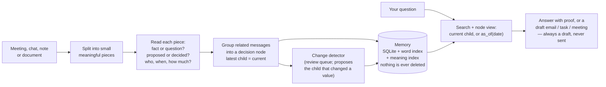
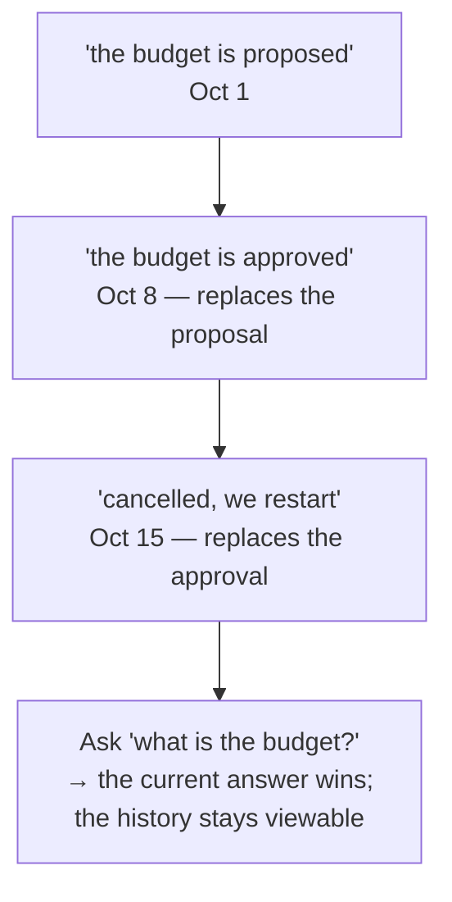

# Semantic Agent Engine

A memory for meeting talk that knows **what is still true**.

If someone says "the budget is proposed", then later "the budget is approved",
and later still "actually, cancelled" — an ordinary search engine finds all
three and picks whichever *sounds* most like your question. This engine groups
the messages that belong to one decision into a **node**; the latest message is
the node's current state, and `as_of(date)` replays the state on an earlier
date. The meeting itself is never rewritten — a later update is a new child,
not an edit. Answers cite the exact sentence they came from.

Architecture v4: `docs/ARCH_V4.md` (seven named steps, synthetic corpus;
diagram in `semantic_agent_engine_architecture_v4_EN.pdf` / `_FR.pdf`). v3 is
kept as rollback in `docs/ARCH_V3.md`.


> Embeddings find *what a sentence is about*. This engine's relation layer
> decides *whether it is still true, and who said it*.

## v4 in one screen

```
immutable message + speaker + timestamp + id
  → sentence spans with offsets (proof)
  → semantic units + piscine tags
  → entity / event / action indexes
  → BM25 + dense + graph expansion
  → contextual reranker (Qwen3-Reranker-0.6B, fused with the pipeline order)
  → append-only typed links + explicit state
  → answer with evidence, or "I don't know"
```

The message is immutable. Links and state are append-only. The node/current
state is a view over them. The seven steps are measured end to end on five
hand-written meetings and 36 questions: **0.778 correct**, the right turn in
the top 10 for **96%** of them, **7 of 10** tricky questions refused. Step by
step: `docs/STEPS_EVAL.md`; inside step 7: `docs/STEP7_DEBUG.md`.

Everything is measured, nothing is asserted: `make report` rebuilds
`docs/REPORT.md` from the artefacts on disk. `docs/BLOCKERS.md` lists what is
**not** met — read it before quoting any number.

---

## 1. How it works



The second box in the diagram — reading every piece — is rules by default:
trained readers must beat the rules on the headline metric before they become
the default (none has yet — see §5). The search box carries one trained part
that *did* win and now ships: a re-scorer that reads your question together
with each candidate and picks the one that actually answers it (the reranker,
shipped default since D-041 — its cost is a ~8 s warm-up, then single-digit
milliseconds per query).



**Why order matters:** nodes are built when a session is *stored*; the detector
runs offline and only proposes review rows. The meeting is immutable, so a wrong
detection is visible as a row, not hidden as a rewritten fact.

**One engine, two jobs.** Meetings/chat are the subject; the same memory,
links and search also serve documents and code — only the splitting differs
(a paragraph, a function). Both paths run in the test suite, not just in prose.

## 2. What the assignment asks for, and where it is proven

The brief's evaluation table, line by line — every value lives in
`docs/REPORT.md` and is regenerated from artefacts:

| The brief asks for | Measured here | In the report |
|---|---|---|
| Retrieval quality (Recall@K, MRR, nDCG@K) | on the synthetic holdout **and** on real French (MIRACL) questions | §4, §6d |
| Specialised embeddings: gain over the stock encoder, hard negatives | a contrastive fine-tune won its own test (hard-negative 0.85→1.0) **and lost the end-to-end metric** — so the stock encoder ships; hard-negative pairs measured apart | §5, §5b, §6c |
| Relations: Macro-F1, per-relation precision/recall, confusion matrix | all three, from the linker stage artefact | §3, §3b |
| Intentions and slots: Macro-F1, slot exactness, right question when unsure | reader scores per head; slots exact-match table; abstention measured on unanswerable questions | §3, §8 |
| Recipient resolution: Precision@1, false recipients, justified abstention | all three measured on fixtures | §8 |
| Answers and dossiers: fact coverage, citation accuracy, unsupported claims | every claim must cite a stored unit; unsupported-claim rate measured | §8, §6f |
| System: latency, memory, cost | cold start reported apart from steady state; per-stage percentiles; VRAM/RAM peaks | §4b |
| Qualitative error analysis | instrument bugs found and fixed are listed with their effect on each number | §9 |
| Split by conversation, never by sentence; unseen projects at test | the split is by project, and the manifest records its own leakage instead of asserting purity | data/splits |

The seven mandatory demo scenarios run end to end on the synthetic corpus
(`make demo`) **and on three real French meetings** (`make demo-real`, 10/10
— with the caveat the artefact itself states: on real speech the topic tags
come from hand labels, not from a working extractor; see §5). The v4 pipeline
prints its own per-step table with `make steps` and its end-to-end score with
`make meetings`.

## 3. Setup and commands

Python 3.14 on an RTX 5060 (8 GB). The venv uses `--system-site-packages`
because the system torch already exists there — **never `uv pip install` ML
packages into it** (it shadows the working torch).

```bash
make setup      # environment + the torch/cuda check
make test       # the full test suite
make meetings   # v4 end to end: 5 hand-written meetings, 36 questions
make steps      # v4 per-step table (store → answerer)
make ask4       # one v4 question by hand: M=data/mine/nova.meeting.json Q="..."
make demo       # the 7 mandatory scenarios, end to end
make demo-real  # the same scenarios on REAL French meetings
make baseline   # the headline comparison, 3 seeds
make frbench    # component checks on real French datasets
make report     # rebuild docs/REPORT.md from the artefacts
make clean
```

Asking the engine things:

```bash
sae ask "Quelle décision a finalement été prise sur le budget d'Atlas ?" --project Atlas
sae ask "Rédige un mail à la personne responsable du budget d'Atlas."   # a draft, never sent
sae history atlas.budget --project Atlas      # every statement about one subject, in order
sae query "le prestataire retenu" --k 5 --json
sae offline --reader model                    # the six nightly batch checks
```

Backends (rules vs trained) are chosen in exactly one place,
`engine/config.py`; the CLI, API, UI and benchmarks read it, so no two of them
can disagree about what ran. Since D-041 the shipped default includes the GPU
reranker, so `make demo`, `make eval-fast` and the served apps want the GPU
free; the CPU test tier pins `rerank: none` and stays model-free.

## 4. The headline number

v4, five hand-written meetings, 36 questions (26 answerable, 10 tricky):

| | value |
|---|---|
| answers correct end to end | **0.778** (formal 0.833 · messy 0.750 · tricky 0.700) |
| answer cites the expected turn | **0.808** |
| right turn in the top 1 / 3 / 10 | .577 / .846 / **.962** |
| tricky questions refused | 7 of 10 |

Same set, three answerers: the deterministic template 0.694, the LLM alone
0.583, the shipped hybrid **0.778** — memory answers when it holds the proof,
the LLM takes the rest. The local model is Qwen3.5-4B by default
(`SAE_OLLAMA_KEEP_ALIVE` keeps it warm between questions); re-measured with it
and no reranker (CPU): **0.806** correct, cites .808, 8/10 refused.

v3's comparison stays as the rollback baseline. Same holdout corpus, same
search budget; the only difference is whether the relation layer is on (both
arms share the reranker — it is search, not the relation layer, so the delta
still isolates the thesis). Test split, 20 projects, 3 seeds:

| | plain search (Baseline A) | with relations (System B) | gain |
|---|---|---|---|
| current version ranked first | 0.2915 | **0.6616** | **+0.3629**, significant on 3/3 seeds |

Honest split of that gain: filtering by project contributes **+0.19**, and only
the relation-layer share (**+0.17**) is the thesis; the absolute target (0.90)
is **not** met.

## 5. What does not work yet (plainly)

- **The synthetic corpus is small and self-authored.** Five meetings, 36
  questions, gold written by the same person who wrote the meetings; the status,
  point and value rules are fitted to them. No meeting is held out yet — that is
  the next honest test, and the score should be expected to drop.
- **hit@1 is .577.** The right turn is in the top 3 for 85% of questions and in
  the top 10 for 96%, but not always first. Pure reranking wins top-1 and loses
  top-3; rank fusion is what ships.
- **3 of 10 tricky questions still get an answer.** The local model turns an
  intention ("we'll send the offer") into a completed act. A larger answerer is
  the missing variable, not another prompt.
- **Two keys for one point.** A turn with no point writes `project:slot`
  alongside `project:slot:point`; the linker should inherit an unambiguous point.
- **Most trained parts are not the defaults.** The trained reader, linker and
  embedder each beat their own narrow test and lose the end-to-end headline;
  rules ship. The reranker is the exception — it won the headline, and the
  owner promoted it to the shipped default (D-041, cost accepted: ~8 s warm-up,
  ~9 ms per query). Each decision is recorded with its numbers.
- **`answers` is never produced** by the shipped linker.
- The concept-attention experiment is built and off: it lost on the real
  French pool that had room to win.

## 6. Where things live

```
src/engine/   the product: segment · read · slots · embed · store · link ·
              retrieve · agent (router, answer, recipients, actions, verify) ·
              concept · offline jobs · cli · engine
src/engine/answer/   answer layer: state answer, LLM answerer, proof check
src/engine/eval/     benchmarks: v4 steps, meetings, step-7 funnel, reranker A/B
src/gen/      the synthetic corpus (gold by construction) and its splits
src/engine/tools/  labelling + measurement tools (validate_dataset …)
api/  ui/     FastAPI and Streamlit over the same engine
schemas/      the JSON contracts (meeting, questions, memory record, …)
data/         corpora, contacts, split manifest, gold labels, data/mine
runs/         every measured artefact   docs/   decisions · blockers · limits ·
              datasets · model cards · the report
tests/        unit · property · integration · golden · e2e
```

## 7. Rules this repo holds itself to

- **Nothing is ever sent.** Every action is a draft, marked "needs
  confirmation".
- **No address, person or decision is invented.** Missing information gets
  asked for; a hypothetical question never triggers an action.
- **Nothing is deleted.** Superseded statements remain as history.
- **Splits are by project, never by sentence**; a spent test read stays spent.
- **A number that cannot move is not a test** — instruments are audited
  before a null result is reported as one.
- Every model is checked against the live registry with its real licence
  (`docs/MODELCARDS.md`) — no invented model names.
