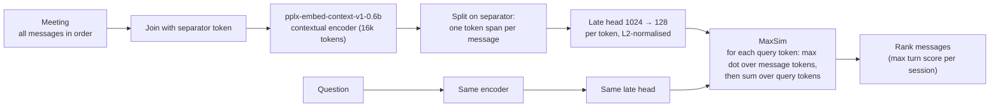

# Semantic Meeting Memory — v7

One corpus, one split protocol, one evaluation for every model. v7 replaces the
separate synthetic/transcribed v6 benchmarks with a project- and
speaker-disjoint corpus and held-out query phrasings.

v6 is archived:

- Data: `data/archive_v6/`
- Results and finetuned v6 models: `artifacts/archive_v6/`
- v6 README: `docs/README_V6.md`

## What v7 is

- 15 projects × 4 meetings, 60 messages per meeting: 60 meetings, 3,600
  messages.
- **Project-disjoint split:** train 9 projects / 36 meetings, val 3 / 12, test
  3 / 12.
- **Speaker-disjoint pools:** train 12 names, val 6, test 6; no overlap.
- **Held-out test phrasings:** train/val use one template family, test uses a
  different paraphrase family. Exact train↔test query overlap is **0**.
- Test projects: **Delta**, **Équinoxe**, **Mistral**. Test speakers: aya,
  ibrahim, lucas, manon, nadia, théo.
- Test queries: 264 — topic-latest-decision, commitment-owner, objection,
  global-latest-decision, latest-message, and a 6-gold decision-count query.
- The corpus is still synthetic, but it no longer uses `décision:` prefixes,
  ISO dates in text, or scripted closings.

Full protocol and tables: [docs/EXPERIMENT_V7.md](docs/EXPERIMENT_V7.md).

## Training protocol

| Component | Trained on | Selected on | Tested on |
|---|---|---|---|
| Custom encoder + topic/act heads | v7 train | v7 val MRR | v7 test |
| Feature-aware retriever | v7 train (encoder) | v7 val policy | v7 test |
| Relation classifier | v7 train pairs | — | v7 test pairs |
| GraphRAG fusion weights | v7 train | v7 val | v7 test |
| French ME5 / multilingual E5 | v7 train (InfoNCE) | v7 val | v7 test |
| BGE-M3 / ColBERT / ColBERTv2 / late chunking | frozen | — | v7 test |

No test query, project, speaker, or relation pair is used for training or
selection.

## v7 test results (264 held-out queries, unseen projects/speakers)

`Recall@K` credits the fraction of gold targets on multi-gold queries;
`AnyR@K` credits at least one gold target.

| Method | R@1 | AnyR@1 | R@5 | AnyR@5 | MRR@10 | nDCG@5 |
|---|---|---:|---:|---:|---:|---:|
| BM25 | 0.119 | 0.125 | 0.344 | 0.352 | 0.210 | 0.236 |
| BGE-M3 · dense only | 0.321 | 0.352 | 0.597 | 0.617 | 0.467 | 0.493 |
| ColBERT · BGE-M3 only | 0.275 | 0.307 | 0.601 | 0.617 | 0.436 | 0.471 |
| **Rexu v2.1 · BGE-M3 FT + ColBERT v1** | **0.614** | **0.652** | **0.895** | **0.905** | **0.756** | **0.787** |
| **Rexu v2.2 · BGE-M3 FT + ColBERTv2** | **0.625** | **0.663** | **0.907** | **0.917** | **0.763** | **0.797** |
| **GraphRAG · FT-ColBERT router** | **0.633** | **0.670** | **0.926** | **0.936** | **0.776** | **0.812** |

**Rexu naming.** v2.1 is BGE-M3 FT + ColBERT v1; v2.2 adds ColBERTv2
compression; v2.3 is archived. The older parser-based temporal path and its
.920 varied-suite number were removed; Rexu v3 is the current default; v2.2 remains the BGE comparison baseline.

## Rexu v3 architecture

Rexu v3 keeps the whole meeting in context instead of pooling each message
alone. Every message is a span separated by the encoder's separator token, so
a message vector already carries what was said before it. Query and document
tokens go through the same 1024→128 late head, and MaxSim scores a query token
against its best match anywhere in the message. No BGE-M3, no graph.



Training uses the v7 train split only: one positive message per query and five
hard negatives (same topic, wrong status/person/date), with the encoder frozen
and the 128-d projection trained. Test queries, projects, speakers and relation
pairs never enter training or model selection.


**Fine-tuning the BGE ColBERT projection is the main win.** The projection is
trained on a 50/50 mixture of v7 train and project-disjoint messy transcriptions,
with one positive + five hard negatives; the base BGE-M3 is frozen. The router
keeps FT ColBERT for semantic queries and uses GraphRAG only for
`latest_message` and global latest-decision queries. Test R@1 .633 / MRR .776,
vs BGE-only .321/.467 and ColBERT-only .275/.436. Graph fusion on every query
**hurts**; routing it only to temporal cases helps. Removed variants remain in
`artifacts/v7_ablation.json`.

Token-level distant-message edges were tested and rejected: 9,774 non-adjacent
MaxSim edges leave the router unchanged, move hybrid R@1 only .534→.542, and
lower R@5. v7 has no cross-meeting/multi-hop queries to reward them.

Hard-negative discrimination on the same split: fine-tuned ColBERT R@5 0.879,
MRR 0.743, gold-beats-hard 0.792, intrusion@5 0.198. Full table:
[docs/EXPERIMENT_V7.md](docs/EXPERIMENT_V7.md).

French ColBERTv2 ablation: frozen `antoinelouis/colbertv2-camembert-L4-mmarcoFR`
scores test R@1 0.265 / MRR 0.372; fine-tuning on v7 train lifts it to
0.398 / 0.528. The full `AdrienB134/ColBERTv2.0-mmarcoFR` (12 layers, 110M)
scores 0.303 / 0.406 frozen and 0.458 / 0.581 with a fine-tuned projection.
ColBERT-XM (`fr_XX`, 128-d, 4 epochs) reaches 0.519 / 0.629; its 38 MB index is
9× smaller than BGE's, but query latency is 59 ms vs 6.5 ms and total adapters
are 852M params. Temporal reranking lifts XM to 0.530 / 0.651 and BGE to
0.670 / 0.769, but does not fix topic/objection. BGE remains the best ColBERT
backbone; not adopted.

## Seen templates vs held-out phrasings

In-distribution = v7 val (same template family as train, unseen projects and
speakers). OOD = v7 test (held-out phrasings, unseen projects and speakers).

| Method | Val R@1 | Test R@1 | Val MRR | Test MRR |
|---|---:|---:|---:|---:|
| BM25 | 0.175 | 0.125 | 0.288 | 0.210 |
| BGE-M3 · dense only | 0.381 | 0.352 | 0.493 | 0.467 |
| ColBERT · BGE-M3 only | 0.337 | 0.307 | 0.474 | 0.436 |
| Rexu v2.2 | 0.806 | 0.663 | 0.867 | 0.763 |

## Per unseen project (Recall@1 / MRR@10)

| Method | Delta | Équinoxe | Mistral |
|---|---|---|---|
| BGE-M3 · dense only | 0.375 / 0.494 | 0.330 / 0.437 | 0.352 / 0.469 |
| ColBERT · BGE-M3 only | 0.318 / 0.454 | 0.284 / 0.407 | 0.318 / 0.446 |
| Rexu v2.2 | 0.648 / 0.759 | 0.682 / 0.772 | 0.659 / 0.759 |

## Components

- Topic head macro-F1 0.647; act head macro-F1 0.960.
- Relation classifier macro-F1 0.975 on test pairs (annotation-derived, not
  open-world NLI).
- Memory: 60 meetings, 3,600 messages, 3,600 units, 2,413 relations; 0 hash
  mismatches, 0 missing/orphan vectors.

## Run

```bash
source .venv/bin/activate
pip install -r requirements.txt

# v10 is the hand-written multi-hop corpus
python evaluate_v10.py

# v7 legacy experiment
python evaluate_v7.py --device cuda

# UI
python app.py                               # http://127.0.0.1:5000
# or ./run_app.sh, which uses .venv/bin/python directly
```

The active built-in dataset is **v10 · Les Rivières de Sel**: 5 hand-written
meetings × 55 messages, 19 labelled multi-hop queries, split 9 train / 6 val /
4 test. v7 remains available as `synthetic` (legacy). The generated v8/v9
corpora are archived under `archive/generated_v8_v9/`.

## Defaults

- The UI default is **`v10`** with **`rexu_v3`**. v3.1 is archived.
- `rexu_v3` = pplx-context(full meeting) → contextual 1024-d tokens →
  Dense(1024→128) → MaxSim. No BGE-M3.
- **Rexu v2.1/v2.2**, BM25, BGE-M3 dense, raw BGE-M3 ColBERT, and GraphRAG
  remain available for comparison.
- v10 zero-shot with the existing v3 head: R@1 .500, R@5 1.000, MRR .688,
  Evidence@5 .475, All-Hops@5 .000 on 4 test queries.
- Graph view: projects → meetings in a spaced grid; meeting view: message
  chunks → speakers/acts/topics, with `precedes` and relation edges. Large
  graphs use short meeting labels and retain full titles in the inspector.

## Limits

- Still synthetic. It is harder and leakage-free, but not a real meeting
  corpus. A public corpus with decision annotations (AMI/ICSI/MeetingBank/
  QMSum) is the next required step.
- The relation classifier learns annotation-defined pair types; macro-F1 0.975
  is not evidence of open-world contradiction detection.
- BGE-M3/ColBERT are frozen; only the custom encoder, GraphRAG fusion, and
  ME5/E5 are trained.
- The v7 agent evaluation is not rebuilt; v6 agent cases are archived.
- GraphRAG v2/late chunking is worse on every v7 test; it is not a default.

## Docs

- [docs/EXPERIMENT_V7.md](docs/EXPERIMENT_V7.md) — protocol, full tables,
  per-project results, findings.
- [docs/README_V6.md](docs/README_V6.md) — archived v6 README.
- [docs/DATA_REALISM_AND_TRANSFER.md](docs/DATA_REALISM_AND_TRANSFER.md) — why
  the old cross-dataset comparison was invalid.
- [docs/GRAPH_RAG_V2_ABLATION.md](docs/GRAPH_RAG_V2_ABLATION.md),
  [docs/V1_ERROR_ANALYSIS.md](docs/V1_ERROR_ANALYSIS.md) — v6 diagnostics.
