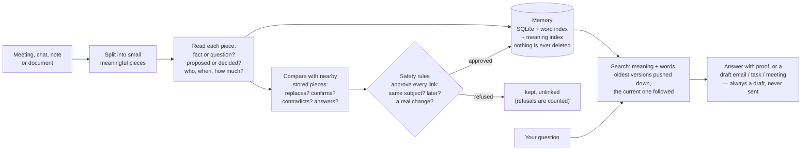
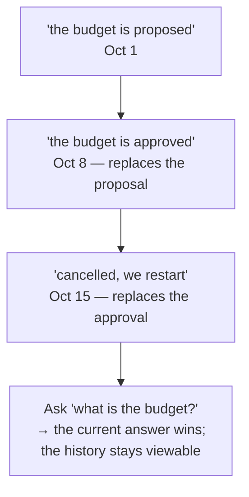

# Semantic Agent Engine

A memory for meeting talk that knows **what is still true**.

If someone says "the budget is proposed", then later "the budget is approved",
and later still "actually, cancelled" — an ordinary search engine finds all
three and picks whichever *sounds* most like your question. This engine keeps
each statement with its date, its speaker and its status, links later
statements to earlier ones ("this replaces that"), and answers with the
version that is in force — citing the exact sentence it came from.

> Embeddings find *what a sentence is about*. This engine's relation layer
> decides *whether it is still true, and who said it*.

Everything is measured, nothing is asserted: `make report` rebuilds
`docs/REPORT.md` from the artefacts on disk. `docs/BLOCKERS.md` lists what is
**not** met — read it before quoting any number.

---

## 1. How it works



The second box in the diagram — reading every piece — is the only trained
part, and even it is optional: a rules reader ships by default, and the
trained readers must beat it on the headline metric before they become the
default (none has yet — see §5).



**Why order matters:** linking happens when things are *stored*, not when you
search. The memory has already resolved its own contradictions, so queries stay
fast (about 2 ms) and a wrong link is visible in the store instead of hidden in
a ranking.

**One engine, two jobs.** Meetings/chat are the subject; the same memory,
links and search also serve documents and code — only the splitting differs
(a paragraph, a function). Both paths run in the test suite, not just in prose.

## 2. What the assignment asks for, and where it is proven

The brief's evaluation table, line by line — every value lives in
`docs/REPORT.md` and is regenerated from artefacts:

| The brief asks for | Measured here | In the report |
|---|---|---|
| Retrieval quality (Recall@K, MRR, nDCG@K) | on the synthetic holdout **and** on real French (MIRACL) questions | §4, §6d |
| Specialised embeddings: gain over the stock encoder, hard negatives | a contrastive fine-tune won its own test (hard-negative 0.85→1.0) **and lost the end-to-end metric** — so the stock encoder ships; hard-negative pairs measured apart | §5, §5b, §6c |
| Relations: Macro-F1, per-relation precision/recall, confusion matrix | all three, from the linker stage artefact | §3, §3b |
| Intentions and slots: Macro-F1, slot exactness, right question when unsure | reader scores per head; slots exact-match table; abstention measured on unanswerable questions | §3, §8 |
| Recipient resolution: Precision@1, false recipients, justified abstention | all three measured on fixtures | §8 |
| Answers and dossiers: fact coverage, citation accuracy, unsupported claims | every claim must cite a stored unit; unsupported-claim rate measured | §8, §6f |
| System: latency, memory, cost | cold start reported apart from steady state; per-stage percentiles; VRAM/RAM peaks | §4b |
| Qualitative error analysis | instrument bugs found and fixed are listed with their effect on each number | §9 |
| Split by conversation, never by sentence; unseen projects at test | the split is by project, and the manifest records its own leakage instead of asserting purity | data/splits |

The seven mandatory demo scenarios run end to end on the synthetic corpus
(`make demo`) **and on three real French meetings** (`make demo-real`, 10/10
— with the caveat the artefact itself states: on real speech the topic tags
come from hand labels, not from a working extractor; see §5).

## 3. Setup and commands

Python 3.14 on an RTX 5060 (8 GB). The venv uses `--system-site-packages`
because the system torch already exists there — **never `uv pip install` ML
packages into it** (it shadows the working torch).

```bash
make setup      # environment + the torch/cuda check
make test       # the full test suite
make demo       # the 7 mandatory scenarios, end to end
make demo-real  # the same scenarios on REAL French meetings
make baseline   # the headline comparison, 3 seeds
make frbench    # component checks on real French datasets
make report     # rebuild docs/REPORT.md from the artefacts
make clean
```

Asking the engine things:

```bash
sae ask "Quelle décision a finalement été prise sur le budget d'Atlas ?" --project Atlas
sae ask "Rédige un mail à la personne responsable du budget d'Atlas."   # a draft, never sent
sae history atlas.budget --project Atlas      # every statement about one subject, in order
sae query "le prestataire retenu" --k 5 --json
sae offline --reader model                    # the six nightly batch checks
```

Backends (rules vs trained) are chosen in exactly one place,
`engine/config.py`; the CLI, API, UI and benchmarks read it, so no two of them
can disagree about what ran.

## 4. The headline number

Same holdout corpus, same search budget; the only difference is whether the
relation layer is on. Test split, 20 projects, 3 seeds:

| | plain search (Baseline A) | with relations (System B) | gain |
|---|---|---|---|
| current version ranked first | 0.2498 | **0.5518** | **+0.3077**, significant on 3/3 seeds |

Honest split of that gain: part of it is simply filtering by project, and only
the relation-layer share is the thesis; the absolute target (0.90) is **not**
met. §6d shows the same comparison on real French meetings, where it does not
yet win — that is the open item below, stated in the report as a measured
limit, not as a promise.

## 5. What does not work yet (plainly)

- **Topic tags on real speech.** To link "the buffet is confirmed" to "so we
  pay him then?", something must notice both sentences are about the buffet.
  Six ways to do that were built and measured against one pre-registered bar;
  none passed, and the code was removed (DECISIONS D-026→D-037). The label
  data built along the way — 3,894 hand-labelled real segments — stays in
  `data/gold/` and is what the real-meeting demos read their topic keys from.
  The blocker `B-13` keeps the precise demand: more *matched* annotated
  meetings, not cleverer code.
- **The trained parts are not the defaults.** The trained reader, linker and
  embedder each beat their own narrow test and lose the end-to-end headline;
  rules ship. Each decision is recorded with its numbers.
- **Abstention leaks**: 3 of 12 unanswerable questions still get an answer.
- **`contradicts` is the weakest relation** (most contradictions get written
  as confirmations) — the confusion matrix in §3b shows the shape.
- **`answers` is never produced** by the rules linker.
- The concept-attention experiment is built and off: it lost on the real
  French pool that had room to win.

## 6. Where things live

```
src/engine/   the product: segment · read · slots · embed · store · link ·
              retrieve · agent (router, answer, recipients, actions, verify) ·
              concept · offline jobs · cli · engine
src/gen/      the synthetic corpus (gold by construction) and its splits
src/eval/     benchmarks: temporal · per-stage · oracle swaps · e2e · latency ·
              killtest · concept gate · real-French checks · report generator
src/engine/tools/  labelling + measurement tools (summre_extract · summre_label ·
              summre_reach · verify_models · verify_datasets · fetch_french …)
api/  ui/     FastAPI and Streamlit over the same engine
schemas/      the JSON contracts (unit, relation, email draft, …)
data/         corpora, contacts, split manifest, gold labels
runs/         every measured artefact   docs/   decisions · blockers · limits ·
              datasets · model cards · the report
tests/        unit · property · integration · golden · e2e
```

## 7. Rules this repo holds itself to

- **Nothing is ever sent.** Every action is a draft, marked "needs
  confirmation".
- **No address, person or decision is invented.** Missing information gets
  asked for; a hypothetical question never triggers an action.
- **Nothing is deleted.** Superseded statements remain as history.
- **Splits are by project, never by sentence**; a spent test read stays spent.
- **A number that cannot move is not a test** — instruments are audited
  before a null result is reported as one.
- Every model is checked against the live registry with its real licence
  (`docs/MODELCARDS.md`) — no invented model names.
